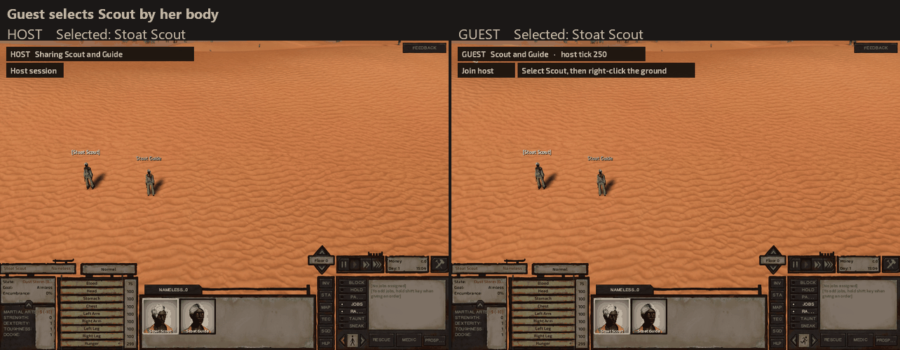

# MeitouP2P-Coop

A two-player **developer preview** for stock Windows MeitouClient **0.20.1 and 0.20.0**. On the same PC, the guest can select Stoat Scout and right-click a destination while the host moves Stoat Guide. Both players retain their own cameras and selections.

Watch the right window as the guest pans away. On returning, a click at the Scout's old spot selects nobody. The guest picks her body at the destination and right-clicks to send her on a second walk. The host keeps the Guide selected on the left. [Results for both builds](docs/stoat-results.md) · [Original 0.20.0 replay](docs/stoat-walk.gif)

## Run the preview

Install the .NET 11 SDK, Python 3, your own Kenshi game and either supported Windows x64 MeitouClient release. Clone `MeitouP2P` and `MeitouP2P-Coop` as sibling folders. From the connector checkout, build both mods against the release you will launch. Use that build for both players. The disposable **Stoat Scout Walk** fixture supplies the two matching characters. [Build both mods](https://github.com/mattresspad/MeitouP2P#build-and-test-with-co-op) · [Launch the two windows](https://github.com/mattresspad/MeitouP2P#walk-stoat-scout-in-two-windows) · [Native-input test driver](https://github.com/mattresspad/MeitouP2P/blob/main/tools/stoat-native-walk.py)

MeitouP2P owns the loopback session. Co-op gives the guest permission to move one character in the current host world. The host checks the peer, grant and character before submitting a normal `MoveOrder`. In the named fixture, the guest draws both matching characters from the same host tick using their position, facing and animation. The guest simulation and the rest of the world run locally. Both tested releases use the same private drawing and input hooks. Martin described the available mod hooks during the original 0.20.0 trial. [Upstream answer](https://github.com/VlcekM/MeitouClient/issues/749#issuecomment-6898903424)

## Try the underlying grant through F10

Enable **MeitouP2P** and then **MeitouP2P-Coop** in both disposable profiles. Start the session with the connector's F10 Host and Join actions and keep the host simulation running.

1. Select one player character on the host and choose **Co-op Offer selected**.
2. On the guest, choose **Co-op Observe**, then **Co-op Reply**. Read the role, position and host tick.
3. Pan the guest camera to walkable ground and choose **Co-op Move to camera**. Observe again after movement.
4. Offer a different character on the host. Repeating the guest's previous move requires a fresh observation. Rejoining or replacing the host world requires a fresh offer.

## Author a guest role

Install the provider in Maestro and choose **Label a guest character template** in a separate author project. Select a Character record, enter a pack ID such as `stoat`, a role ID such as `stoat.scout`, and a label such as **Stoat Scout**. Review, save and export. Enable the exported pack after Co-op. The label comes from the pack and the host grants control during play. [Provider descriptor](pack/maestro.json) · [Maestro verification](docs/maestro.md)

The gameplay reference is nhoral's allied two-squad design in *KenshiCoop*, including zeroit789's two-Wanderer start. This preview uses one granted Scout and a Guide in a matching test squad. [KenshiCoop](https://github.com/nhoral/KenshiCoop) · [Licensing and replay notice](LICENSING.md)
